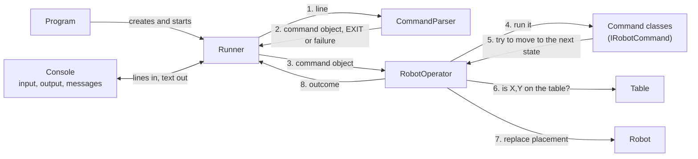
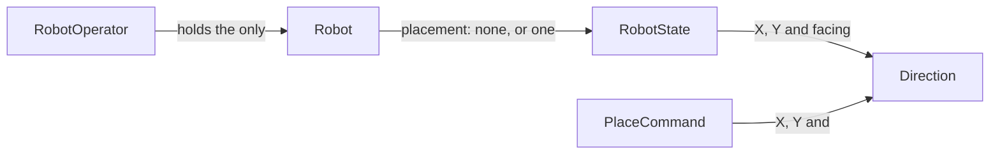

# 5. High-level design

How the application is put together: its parts, how a line flows through them, and where the code and the built application live.

## Architecture

The application is a C# .NET 8 console application made of a small set of parts, called **components**. Each one has a single job, following the SOLID principles ([DEC-26][dec-26], [DEC-34][dec-34]).

**How a line flows.** The arrows show who calls whom and what is passed.



The Runner never uses the console directly. Program hands it a reader for console input (stdin) and writers for console output (stdout) and console messages (stderr), so tests can pass in-memory ones instead ([DEC-29][dec-29]). The diagram shows the console next to the Runner only because the Runner reads and writes through what Program gave it.

**What the robot is made of.**



## How it works

1. **Start-up.** Program checks for arguments. If there are any, it writes the how-to-run message and stops with exit code 1 ([DEC-04][dec-04]). Otherwise it creates the Table (5 x 5), RobotOperator and the Runner, and starts the Runner ([DEC-03][dec-03], [DEC-26][dec-26]). All of this runs inside a last safeguard: an unexpected exception gives one error line in console messages (stderr) and exit code 2 ([DEC-32][dec-32]).
2. **One line at a time.** The Runner reads a line. It writes the prompt before reading (when a person is typing) or the echo after reading (when input is redirected) ([DEC-24][dec-24], [DEC-25][dec-25]).
3. **Format check.** The CommandParser turns the line into a **command object** (one class per robot command, such as `MoveCommand`), EXIT, or a failure with its reason. It checks only the format; whether the position is on the table is not its job ([DEC-27][dec-27], [DEC-28][dec-28]).
4. **A failure** is shown as a warning in console messages (stderr) and never reaches RobotOperator ([DEC-27][dec-27]).
5. **EXIT** stops the Runner; RobotOperator never sees it ([DEC-30][dec-30]).
6. **Shared rules, then the command.** The Runner passes the command object to RobotOperator. RobotOperator first checks the rule shared by all commands: the robot must be on the table (except for PLACE). Then it runs the command ([DEC-27][dec-27]).
7. **The command's own logic.** The command works out where the robot would go next (PLACE, MOVE, LEFT, RIGHT) and asks RobotOperator to move it there; REPORT just reads the position. Commands reach the robot only through the `IRobotOperator` interface, never the Robot itself ([DEC-14][dec-14]).
8. **Check, then replace.** RobotOperator asks the Table whether the new position is on the table, and replaces the Robot's state only if it is. This check is written once, for every command ([DEC-13][dec-13]).
9. **Outcome.** RobotOperator returns the position text for REPORT, a warning, or "done, nothing to show". The Runner writes `Output:` and the position to console output (stdout), or the warning to console messages (stderr) ([DEC-21][dec-21], [DEC-23][dec-23]).
10. **End.** At EXIT or the end of the input, the Runner returns and Program exits with code 0 ([DEC-10][dec-10]).

## Who creates what

| Component | Created by | Receives |
|---|---|---|
| Table | Program | Its width and height (5 and 5) |
| RobotOperator | Program | The Table |
| Robot | RobotOperator | Nothing; it starts not on the table |
| Runner | Program | The input reader, the output and error writers, RobotOperator, and whether a person is typing |
| CommandParser | Runner | Nothing; it has no settings or state |
| A command object (`PlaceCommand`, `MoveCommand`, `LeftCommand`, `RightCommand`, `ReportCommand`) | CommandParser, one for each valid robot command line | For `PlaceCommand`: X, Y and F |

Only Program knows about the real console. Only RobotOperator can reach the Robot; command objects change it only through `IRobotOperator` ([DEC-14][dec-14], [DEC-26][dec-26], [DEC-29][dec-29]).

## Design principles

The design follows the **SOLID** principles ([DEC-34][dec-34]):

- **Single responsibility: each part has one job.** Each command class holds only its own logic; the parser checks format; the Table checks position; the Runner handles input and output; RobotOperator holds the shared rules ([DEC-26][dec-26], [DEC-28][dec-28]).
- **Open/closed: a new command is a new class.** The existing command classes do not change; only the CommandParser learns the new word ([DEC-27][dec-27]).
- **Small interfaces.** Commands see the robot only through `IRobotOperator` (the current state, and one way to move the robot), so no command can change the robot any other way ([DEC-14][dec-14], [DEC-27][dec-27]).
- **Shared rules written once.** "The robot must be on the table" and "check with the Table before replacing" live only in RobotOperator, so they cannot drift apart between commands ([DEC-13][dec-13], [DEC-27][dec-27]).
- **The robot's state is replaced, never changed.** A new state is built and checked first, so a failed check never leaves the robot half-changed ([DEC-12][dec-12], [DEC-13][dec-13]).
- **Nothing depends on the real console except Program,** so the whole flow runs in memory in tests ([DEC-29][dec-29], [DEC-31][dec-31]).
- **Room to grow without building it now.** More robots would change only the CommandParser and RobotOperator ([DEC-38][dec-38]).

The details of each component are on page [6](06-components.md); step-by-step flows are on page [7](07-logical-flow.md).

## Folder layout and the built application

```text
toy-robot-spec-driven/
├── src/
│   └── ToyRobot/                 the application (all components)
│       ├── Program.cs            Program
│       ├── Session/              Runner
│       ├── Parsing/              CommandParser and its parse result
│       ├── Commands/             the command interface, one class per command, and the outcome
│       └── Domain/               Table, Direction, RobotState, Robot and RobotOperator
├── tests/
│   ├── ToyRobot.Tests/           Unit/ (unit tests) and RunnerWholeFlow/ (Runner whole-flow tests, in memory)
│   └── ToyRobot.ConsoleEndToEndTests/   console end-to-end tests of the built application
├── testdata/                     input files with matching expected-output files
├── docs/                         challenge, design analysis, solution design
├── .github/workflows/            the CI workflow (page 9)
├── ToyRobot.sln                  the solution file that groups the three projects
├── run.cmd                       run script for Windows (cmd and PowerShell)
├── run.sh                        run script for Linux and macOS
├── .gitattributes                line-ending rules
└── README.md                     the README
```

- The tests use **xUnit**, a common .NET test framework.
- **The built application.** [DEC-04][dec-04] uses `ToyRobot` to stand for the built application and leaves its exact path to this page. The run scripts build the `Release` configuration (the optimised build, as opposed to `Debug`), so the application is at:
  - Windows: `src\ToyRobot\bin\Release\net8.0\ToyRobot.exe`
  - Linux and macOS: `src/ToyRobot/bin/Release/net8.0/ToyRobot`
- `dotnet build` and `dotnet test` run from the repository root, using `ToyRobot.sln`.

---

Back to the [solution design overview](README.md).

[dec-03]: ../design-analysis/design-decisions.md#dec-03-table-size-is-a-constructor-parameter
[dec-04]: ../design-analysis/design-decisions.md#dec-04-standard-input-only
[dec-10]: ../design-analysis/design-decisions.md#dec-10-ending-a-session
[dec-12]: ../design-analysis/design-decisions.md#dec-12-robot-state-is-an-immutable-value
[dec-13]: ../design-analysis/design-decisions.md#dec-13-state-is-replaced-never-changed-in-place
[dec-14]: ../design-analysis/design-decisions.md#dec-14-only-one-way-to-change-the-robot
[dec-21]: ../design-analysis/design-decisions.md#dec-21-report-format
[dec-23]: ../design-analysis/design-decisions.md#dec-23-output-channels
[dec-24]: ../design-analysis/design-decisions.md#dec-24-prompt
[dec-25]: ../design-analysis/design-decisions.md#dec-25-echo-with-redirected-input
[dec-26]: ../design-analysis/design-decisions.md#dec-26-responsibilities
[dec-27]: ../design-analysis/design-decisions.md#dec-27-each-command-is-a-class-robotoperator-holds-the-shared-rules
[dec-28]: ../design-analysis/design-decisions.md#dec-28-the-parser-checks-format-the-table-checks-position
[dec-29]: ../design-analysis/design-decisions.md#dec-29-the-runner-receives-everything-it-uses
[dec-30]: ../design-analysis/design-decisions.md#dec-30-exit-is-handled-by-the-runner
[dec-31]: ../design-analysis/design-decisions.md#dec-31-testing
[dec-32]: ../design-analysis/design-decisions.md#dec-32-never-crash
[dec-34]: ../design-analysis/design-decisions.md#dec-34-readable-code-solid
[dec-38]: ../design-analysis/design-decisions.md#dec-38-one-robot-now-room-for-more-later
