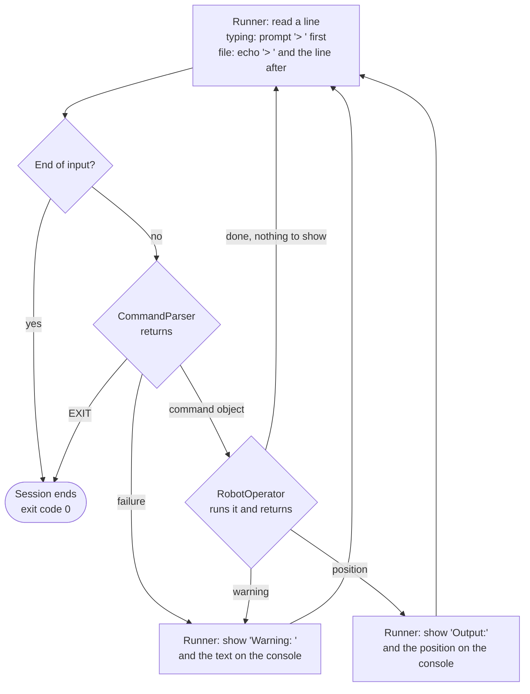

# 7. Logical flow and sequence diagrams

How one line is processed, step by step, and how the components talk to each other in the main scenarios.

The components are described on page [6](06-components.md).

## How to read the diagrams

- **Console.** Everything the person sees appears on the console: the `> ` prompt, the echo of each line, warnings, and the REPORT result. The REPORT result (`Output:` and the position) is kept separate from the rest, so it can be saved on its own ([DEC-23][dec-23]). In the sequence diagrams, arrows to the Console labelled `result:` carry that REPORT result, which is console output (stdout); every other arrow to the Console is a console message (stderr). The terms are defined on the [overview page](README.md).
- **Echo.** Input comes from a file unless a diagram says otherwise. So after reading each line, the Runner **echoes** it on the console as `> ` and the line (the `echo:` arrows). The echo is not the command running; it makes a file run read like the challenge examples, and it is never mixed into the REPORT result ([DEC-25][dec-25]).
- **Outcome.** RobotOperator always returns an outcome to the Runner: the position text (REPORT), a warning, or "done, nothing to show" (a PLACE, MOVE, LEFT or RIGHT that was carried out). Only the Runner shows anything on the console ([DEC-26][dec-26]).

## How one line is processed

One picture of every path a line can take. The Runner is in charge throughout: it reads the line, passes it to the CommandParser, passes the command object to RobotOperator, and does all the showing. The sequence diagrams (below) show the details of each path.

- **Typing or a file.** The `> ` prompt is shown only when a person is typing; the echo only when input comes from a file ([DEC-24][dec-24], [DEC-25][dec-25]). On the first line a byte-order mark is removed, and nothing is read ahead, so the first prompt is never delayed ([DEC-20][dec-20]).
- **Who acts.** The CommandParser and RobotOperator never show anything; they only return a result to the Runner ([DEC-21][dec-21], [DEC-26][dec-26], [DEC-27][dec-27]).
- **What never reaches RobotOperator.** A failure, and EXIT ([DEC-27][dec-27], [DEC-30][dec-30]).
- **Never stuck.** Every path except EXIT and the end of input goes back to read the next line, so no bad input stops the session ([DEC-32][dec-32]).

## Sequence diagrams

Each scenario has its own page, with one sequence diagram and a short explanation.

| # | Scenario | Input and requirements |
|---|---|---|
| 7.1 | [Valid PLACE, then REPORT](07-logical-flow/01-place-then-report.md) | Input: `PLACE 0,0,NORTH`, then `REPORT`. Requirements: [FR-02][fr-02], [FR-06][fr-06]. |
| 7.2 | [MOVE blocked at the edge](07-logical-flow/02-move-blocked-at-the-edge.md) | The robot is at 4,2,EAST. Input: `MOVE`. Requirement: [FR-04][fr-04]. |
| 7.3 | [Commands before a valid PLACE](07-logical-flow/03-commands-before-place.md) | The robot is not on the table. Input: `MOVE`. Requirement: [FR-07][fr-07]. |
| 7.4 | [A bad line](07-logical-flow/04-bad-line.md) | Input: `HELLO`. Requirement: [FR-10][fr-10]. |
| 7.5 | [PLACE off the table](07-logical-flow/05-place-off-the-table.md) | Input: `PLACE 9,9,NORTH`. Requirement: [FR-02][fr-02]. |
| 7.6 | [EXIT](07-logical-flow/06-exit.md) | Input: `EXIT`, followed by more lines. Requirement: [FR-15][fr-15]. |
| 7.7 | [Start-up](07-logical-flow/07-start-up.md) | Requirements: [FR-13][fr-13], [FR-14][fr-14], [FR-17][fr-17], [FR-18][fr-18]. |

---

Back to the [solution design overview](README.md).

[dec-20]: ../design-analysis/design-decisions.md#dec-20-bad-lines
[dec-21]: ../design-analysis/design-decisions.md#dec-21-report-format
[dec-23]: ../design-analysis/design-decisions.md#dec-23-output-channels
[dec-24]: ../design-analysis/design-decisions.md#dec-24-prompt
[dec-25]: ../design-analysis/design-decisions.md#dec-25-echo-with-redirected-input
[dec-26]: ../design-analysis/design-decisions.md#dec-26-responsibilities
[dec-27]: ../design-analysis/design-decisions.md#dec-27-each-command-is-a-class-robotoperator-holds-the-shared-rules
[dec-30]: ../design-analysis/design-decisions.md#dec-30-exit-is-handled-by-the-runner
[dec-32]: ../design-analysis/design-decisions.md#dec-32-never-crash
[fr-02]: 02-functional-requirements.md#fr-02
[fr-04]: 02-functional-requirements.md#fr-04
[fr-06]: 02-functional-requirements.md#fr-06
[fr-07]: 02-functional-requirements.md#fr-07
[fr-10]: 02-functional-requirements.md#fr-10
[fr-13]: 02-functional-requirements.md#fr-13
[fr-14]: 02-functional-requirements.md#fr-14
[fr-15]: 02-functional-requirements.md#fr-15
[fr-17]: 02-functional-requirements.md#fr-17
[fr-18]: 02-functional-requirements.md#fr-18
