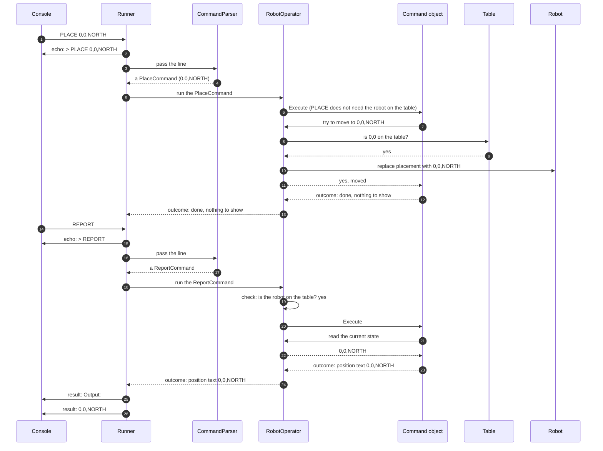

# 7.1 Valid PLACE, then REPORT

How the components work together when a valid PLACE is followed by REPORT.

How to read these diagrams: see [page 7](../07-logical-flow.md#how-to-read-the-diagrams).

Input: `PLACE 0,0,NORTH`, then `REPORT`. Requirements: [FR-02][fr-02], [FR-06][fr-06].

The Command object participant stands for whichever command class the parser created: a `PlaceCommand` in the first half and a `ReportCommand` in the second. RobotOperator returns only the position text; the Runner writes the `Output:` label before it ([DEC-21][dec-21]). Every change to the robot goes through RobotOperator's single "check, then replace" step ([DEC-13][dec-13], [DEC-27][dec-27]).

## Step by step

The numbers match the arrows in the diagram.

1. The console gives the Runner the first line, `PLACE 0,0,NORTH` (here, read from a file).
2. The Runner echoes the line as a console message (stderr), so the person can see which line is being handled.
3. The Runner passes the line to the CommandParser.
4. The CommandParser checks the format and creates a `PlaceCommand` holding X = 0, Y = 0, facing NORTH. It does not check the table; that is not its job.
5. The Runner passes the command object to RobotOperator.
6. PLACE is how the robot gets on the table, so RobotOperator does not check whether it is already there. It runs the command, handing it `IRobotOperator`, never the Robot itself.
7. The `PlaceCommand` asks RobotOperator to move the robot to 0,0,NORTH.
8. RobotOperator asks the Table: is 0,0 on the table?
9. The Table answers yes.
10. RobotOperator puts the robot at 0,0, facing NORTH. This is the first time the robot is on the table.
11. RobotOperator tells the command that the move worked.
12. The command returns its outcome: "done, nothing to show".
13. RobotOperator passes that outcome to the Runner, which shows nothing and reads the next line.
14. The console gives the Runner the next line, `REPORT`.
15. The Runner echoes it as a console message (stderr).
16. The Runner passes the line to the CommandParser.
17. The CommandParser creates a `ReportCommand`, which holds no values.
18. The Runner passes the command object to RobotOperator.
19. REPORT needs the robot on the table, so RobotOperator checks that first. It is.
20. RobotOperator runs the `ReportCommand`.
21. The command asks RobotOperator for the current state (`CurrentState`). It can read the state but cannot change it this way.
22. RobotOperator answers: 0,0, facing NORTH.
23. The command returns the state as text, `0,0,NORTH`, without any label.
24. RobotOperator passes that outcome to the Runner.
25. The Runner shows the label `Output:` as console output (stdout). The label is added by the Runner, not by the command.
26. The Runner shows `0,0,NORTH` as console output (stdout). These two lines are the only console output in this scenario.

---

Back to [page 7](../07-logical-flow.md) · [solution design overview](../README.md)

[dec-13]: ../../design-analysis/design-decisions.md#dec-13-state-is-replaced-never-changed-in-place
[dec-21]: ../../design-analysis/design-decisions.md#dec-21-report-format
[dec-27]: ../../design-analysis/design-decisions.md#dec-27-each-command-is-a-class-robotoperator-holds-the-shared-rules
[fr-02]: ../02-functional-requirements.md#fr-02
[fr-06]: ../02-functional-requirements.md#fr-06
