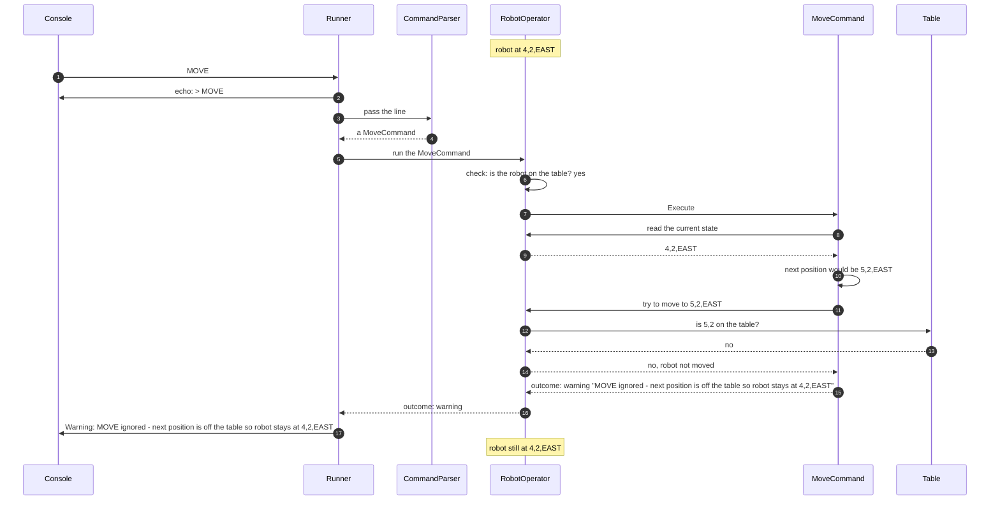

# 7.2 MOVE blocked at the edge

How a MOVE that would take the robot off the table is refused.

How to read these diagrams: see [page 7](../07-logical-flow.md#how-to-read-the-diagrams).

The robot is at 4,2,EAST. Input: `MOVE`. Requirement: [FR-04][fr-04].

The next position is checked before the robot moves, so there is nothing to undo ([DEC-13][dec-13], [DEC-16][dec-16]). The `MoveCommand` works out where the robot would go and writes its own warning; RobotOperator does the check that every command shares ([DEC-27][dec-27]).

## Step by step

The numbers match the arrows in the diagram. Before the first step, the robot is at 4,2, facing EAST: on the east edge of the table.

1. The console gives the Runner the line `MOVE`.
2. The Runner echoes it as a console message (stderr).
3. The Runner passes the line to the CommandParser.
4. The CommandParser creates a `MoveCommand`.
5. The Runner passes the command object to RobotOperator.
6. MOVE needs the robot on the table, so RobotOperator checks that first. It is.
7. RobotOperator runs the `MoveCommand`, handing it `IRobotOperator`.
8. The command asks RobotOperator for the current state (`CurrentState`).
9. RobotOperator answers: 4,2, facing EAST.
10. The command works out where the robot would go: one step EAST adds 1 to X, so the next position would be 5,2, still facing EAST. The robot has not moved.
11. The command asks RobotOperator to move the robot to 5,2,EAST.
12. RobotOperator asks the Table: is 5,2 on the table?
13. The Table answers no: X can only be 0 to 4.
14. RobotOperator leaves the robot where it is and tells the command the move did not happen. Because the robot was never moved, there is nothing to undo.
15. The command returns its warning, with the position where the robot stays.
16. RobotOperator passes the warning to the Runner.
17. The Runner shows the warning as a console message (stderr), adding the `Warning: ` prefix.

After the last step the robot is still at 4,2, facing EAST. The next line is handled as normal, so a later valid command, such as LEFT and then MOVE, still works.

---

Back to [page 7](../07-logical-flow.md) · [solution design overview](../README.md)

[dec-13]: ../../design-analysis/design-decisions.md#dec-13-state-is-replaced-never-changed-in-place
[dec-16]: ../../design-analysis/design-decisions.md#dec-16-move
[dec-27]: ../../design-analysis/design-decisions.md#dec-27-each-command-is-a-class-robotoperator-holds-the-shared-rules
[fr-04]: ../02-functional-requirements.md#fr-04
