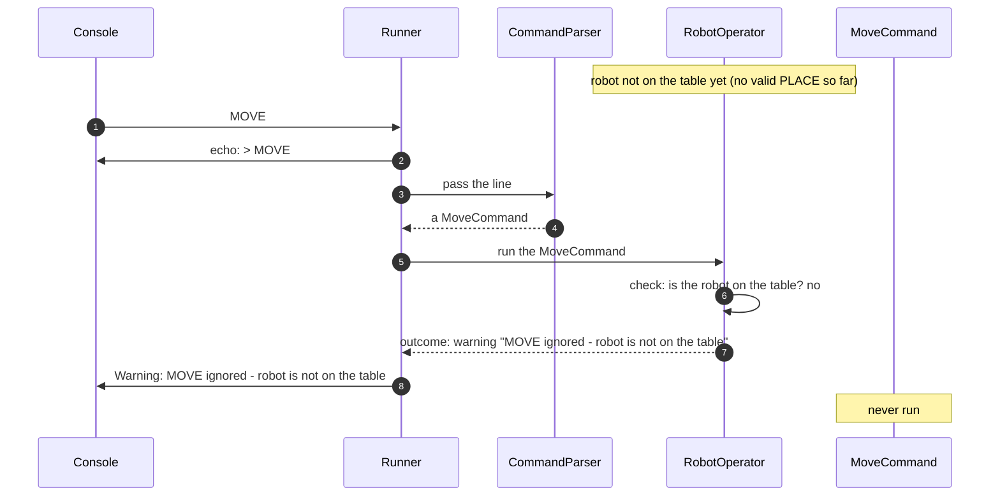

# 7.3 Commands before a valid PLACE

How a robot command is ignored while the robot is not on the table.

How to read these diagrams: see [page 7](../07-logical-flow.md#how-to-read-the-diagrams).

The robot is not on the table. Input: `MOVE`. Requirement: [FR-07][fr-07].

The "is the robot on the table?" check is shared by MOVE, LEFT, RIGHT and REPORT, so RobotOperator does it once, before running any command. The command itself is never run, and the Table is not asked, because there is no position to check ([DEC-11][dec-11], [DEC-19][dec-19], [DEC-27][dec-27]).

## Step by step

The numbers match the arrows in the diagram. Before the first step, there has been no valid PLACE, so the robot is not on the table.

1. The console gives the Runner the line `MOVE`.
2. The Runner echoes it as a console message (stderr).
3. The Runner passes the line to the CommandParser.
4. The CommandParser creates a `MoveCommand`. The line is a valid command; the parser does not know where the robot is.
5. The Runner passes the command object to RobotOperator.
6. MOVE needs the robot on the table, so RobotOperator checks first. The robot is not on the table.
7. RobotOperator returns the warning straight away, using the command's name. The `MoveCommand` is never run, and the robot stays off the table.
8. The Runner shows the warning as a console message (stderr).

LEFT, RIGHT and REPORT follow exactly the same steps, with their own name in the warning. Only a valid PLACE can put the robot on the table.

---

Back to [page 7](../07-logical-flow.md) · [solution design overview](../README.md)

[dec-11]: ../../design-analysis/design-decisions.md#dec-11-the-robot-exists-from-the-start-not-on-the-table
[dec-19]: ../../design-analysis/design-decisions.md#dec-19-robot-commands-before-the-robot-is-on-the-table
[dec-27]: ../../design-analysis/design-decisions.md#dec-27-each-command-is-a-class-robotoperator-holds-the-shared-rules
[fr-07]: ../02-functional-requirements.md#fr-07
