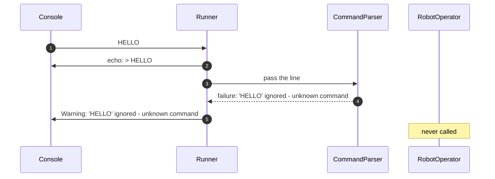

# 7.4 A bad line

How a line that is not a valid command is handled.

How to read these diagrams: see [page 7](../07-logical-flow.md#how-to-read-the-diagrams).

Input: `HELLO`. Requirement: [FR-10][fr-10].

The CommandParser returns a failure instead of throwing an exception, and the Runner writes it as a warning ([DEC-20][dec-20], [DEC-22][dec-22], [DEC-27][dec-27]). Every other kind of bad line follows the same path with its own reason.

## Step by step

The numbers match the arrows in the diagram.

1. The console gives the Runner the line `HELLO`.
2. The Runner echoes it as a console message (stderr). Bad lines are echoed like every other line.
3. The Runner passes the line to the CommandParser.
4. `HELLO` is not one of the six commands, so the CommandParser returns a failure with its reason. No command object is created. It does not throw an exception, so nothing can crash.
5. The Runner shows the reason as a console message (stderr), adding the `Warning: ` prefix.

RobotOperator is never called, so the robot does not change. The Runner reads the next line as normal. Every other kind of bad line, such as `PLACE 1,2` or `move now`, follows the same five steps with its own reason (the full list is on [page 2](../02-functional-requirements.md)).

---

Back to [page 7](../07-logical-flow.md) · [solution design overview](../README.md)

[dec-20]: ../../design-analysis/design-decisions.md#dec-20-bad-lines
[dec-22]: ../../design-analysis/design-decisions.md#dec-22-warning-wording
[dec-27]: ../../design-analysis/design-decisions.md#dec-27-each-command-is-a-class-robotoperator-holds-the-shared-rules
[fr-10]: ../02-functional-requirements.md#fr-10
