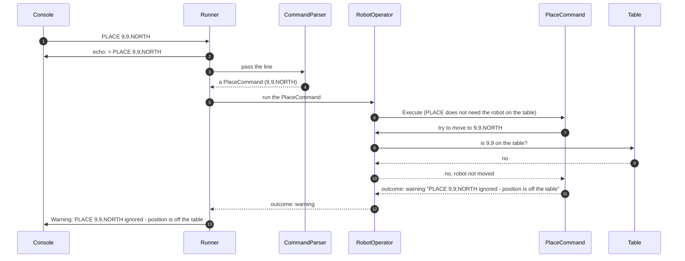

# 7.5 PLACE off the table

How a PLACE whose position is off the table is refused.

How to read these diagrams: see [page 7](../07-logical-flow.md#how-to-read-the-diagrams).

Input: `PLACE 9,9,NORTH`. Requirement: [FR-02][fr-02].

The line is well-formed, so the CommandParser accepts it; only the Table knows that 9,9 is off the table ([DEC-28][dec-28]). The robot keeps its previous placement, or stays off the table if it had none ([DEC-15][dec-15]).

## Step by step

The numbers match the arrows in the diagram.

1. The console gives the Runner the line `PLACE 9,9,NORTH`.
2. The Runner echoes it as a console message (stderr).
3. The Runner passes the line to the CommandParser.
4. The format is correct (three values, two whole numbers and a valid direction), so the CommandParser creates a `PlaceCommand` holding 9, 9 and NORTH. It does not check the table.
5. The Runner passes the command object to RobotOperator.
6. PLACE does not need the robot on the table, so RobotOperator runs it straight away.
7. The `PlaceCommand` asks RobotOperator to move the robot to 9,9,NORTH.
8. RobotOperator asks the Table: is 9,9 on the table?
9. The Table answers no: X and Y can only be 0 to 4.
10. RobotOperator leaves the robot unchanged and tells the command the move did not happen. The robot stays where it was, or stays off the table if it had not been placed yet.
11. The command returns its warning. The values in it are the numbers and direction as read, in upper case.
12. RobotOperator passes the warning to the Runner.
13. The Runner shows the warning as a console message (stderr).

---

Back to [page 7](../07-logical-flow.md) · [solution design overview](../README.md)

[dec-15]: ../../design-analysis/design-decisions.md#dec-15-place
[dec-28]: ../../design-analysis/design-decisions.md#dec-28-the-parser-checks-format-the-table-checks-position
[fr-02]: ../02-functional-requirements.md#fr-02
