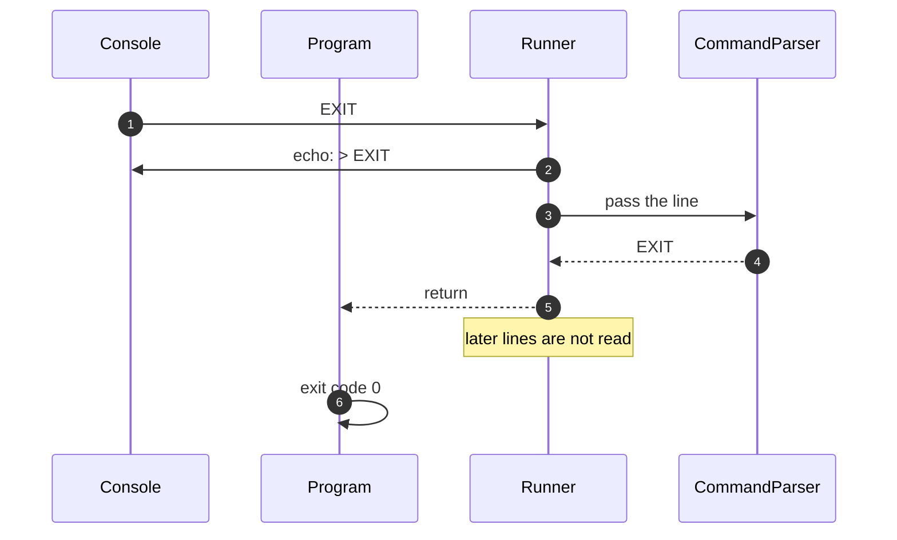

# 7.6 EXIT

How EXIT ends the session.

How to read these diagrams: see [page 7](../07-logical-flow.md#how-to-read-the-diagrams).

Input: `EXIT`, followed by more lines. Requirement: [FR-15][fr-15].

The Runner handles EXIT itself; RobotOperator never sees it, so the "on the table?" rule never applies ([DEC-10][dec-10], [DEC-30][dec-30]). The end of the input follows the same path from "return".

## Step by step

The numbers match the arrows in the diagram.

1. The console gives the Runner the line `EXIT`.
2. The Runner echoes it as a console message (stderr), like every other line.
3. The Runner passes the line to the CommandParser.
4. The CommandParser returns EXIT. EXIT is not a command object, because it is not a robot command. Anything after EXIT on the same line is ignored, so `EXIT now` also ends the session.
5. The Runner stops and hands control back to Program. RobotOperator never sees EXIT. The lines after EXIT are not read, so they are neither echoed nor run.
6. Program stops with exit code 0, which tells the shell everything went normally.

When the input simply runs out (the end of the file, or Ctrl+Z / Ctrl+D when typing), the Runner follows the same path from step 5. The Windows console gives Ctrl+Z then Enter as a line that holds only the character Ctrl+Z (U+001A), not as the end of the input; the Runner treats that line as the end of the input too, so nothing after it is read or run and no warning is written ([DEC-10][dec-10]).

---

Back to [page 7](../07-logical-flow.md) · [solution design overview](../README.md)

[dec-10]: ../../design-analysis/design-decisions.md#dec-10-ending-a-session
[dec-30]: ../../design-analysis/design-decisions.md#dec-30-exit-is-handled-by-the-runner
[fr-15]: ../02-functional-requirements.md#fr-15
