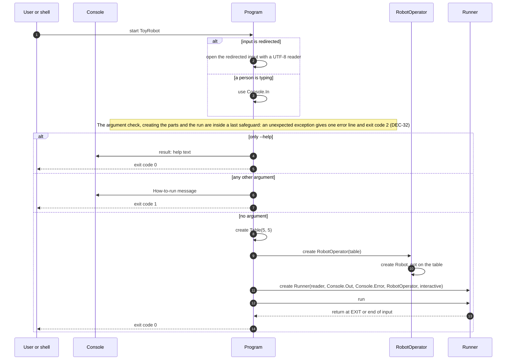

# 7.7 Start-up

How the application starts: the argument check (help, or the how-to-run message), and typed versus redirected input.

How to read these diagrams: see [page 7](../07-logical-flow.md#how-to-read-the-diagrams).

Requirements: [FR-13][fr-13], [FR-14][fr-14], [FR-17][fr-17], [FR-18][fr-18].



## Step by step

The numbers match the arrows in the diagram. The grey boxes marked **alt** are "either / or" choices: only one branch happens.

1. **Start.** The user starts the application, either directly or through a run script.

**First choice: are the commands coming from a file, or is a person typing?** Program checks this once, with `Console.IsInputRedirected` ([DEC-24][dec-24]). Choosing the reader reads nothing yet.

2. **From a file (or a pipe).** Program opens the input with a UTF-8 reader (UTF-8 is the usual way of storing text). This reader also removes a byte-order mark, the invisible marker some editors put at the start of a file ([DEC-20][dec-20]).
3. **A person is typing.** Program uses the normal keyboard input of the console (`Console.In`).

**Second choice: was anything typed after the application's name?**

4. **Only `--help` was typed after the name** (`ToyRobot --help`). Program shows the help text as console output (stdout): how to start the application, the table, each command and the rules, and how a session ends. It does not read any commands ([DEC-04][dec-04]).
5. Program stops with **exit code 0**, because the user asked for help and got it. Nothing else happens.
6. **Anything else was typed after the name** (for example `ToyRobot commands.txt`, `ToyRobot -h` or `ToyRobot --help commands.txt`). The application takes no other arguments, so Program shows the how-to-run message as a console message (stderr). It does not read any commands ([DEC-04][dec-04]).
7. Program stops with **exit code 1**, which tells the shell the application was used the wrong way. Nothing else happens.

**Otherwise (nothing after the name), Program sets everything up and runs:**

8. **Create the table.** Program creates a 5 x 5 table ([DEC-03][dec-03]).
9. **Create RobotOperator** and give it the table, so it can ask "is this position on the table?" later.
10. **RobotOperator creates the robot.** The robot exists from the start but is not on the table yet; it has no position until a valid PLACE ([DEC-11][dec-11]).
11. **Create the Runner.** Program hands the Runner everything it needs: the input chosen in step 2 or 3, the console output (stdout, `Console.Out`), the console messages (stderr, `Console.Error`), RobotOperator, and whether a person is typing (`interactive`). Because the Runner is given these instead of using the console itself, tests can give it in-memory text instead ([DEC-29][dec-29]).
12. **Run.** The Runner now reads and handles one line at a time, as shown on [page 7](../07-logical-flow.md#how-one-line-is-processed). When a person is typing it shows the `> ` prompt; when input comes from a file it echoes each line instead.
13. **The Runner finishes** when it reads EXIT or reaches the end of the input, and hands control back to Program.
14. Program stops with **exit code 0**, which tells the shell everything went normally ([DEC-10][dec-10]).

**If something unexpected goes wrong.** The argument check, creating the parts and running the Runner are inside a last safeguard (the note in the diagram). Choosing the reader in steps 2 and 3 reads nothing, so Program does it first, outside the safeguard. No input causes this, but if an exception escapes, for example because the console or a pipe closes while the application writes, Program writes one line, `Error: unexpected problem - <exception message>`, as a console message (stderr) and stops with **exit code 2**, instead of showing a .NET stack trace. If even that line cannot be written, it still stops with exit code 2 ([DEC-32][dec-32]).

## What is a byte-order mark?

A **byte-order mark** (BOM) is an invisible marker at the very start of a text file. Some editors add it when they save a file, for example Windows Notepad in some modes, or Visual Studio. It is a few hidden bytes that tell other programs "this file is stored as UTF-8 text". You cannot see it when you open the file, but a program that reads the file does get it.

**Why it matters here.** If `commands.txt` is saved with a BOM and its first line is `PLACE 0,0,NORTH`, then without special handling the application would actually read:

```text
[invisible marker]PLACE 0,0,NORTH
```

The command word would then be "marker + PLACE", which is not a known command. The very first command would be rejected with a confusing warning, even though the file looks correct.

**What the design does about it** ([DEC-20][dec-20]). The marker is removed before the first line is handled, in two places:
- Program's UTF-8 reader removes it when input comes from a file (step 2 above).
- The Runner also removes it from the start of the first line, so the in-memory tests behave the same way.

So the file just works. [FR-11][fr-11] on [page 2](../02-functional-requirements.md) checks this: a file with a BOM gives exactly the same result as one without.

---

Back to [page 7](../07-logical-flow.md) · [solution design overview](../README.md)

[dec-03]: ../../design-analysis/design-decisions.md#dec-03-table-size-is-a-constructor-parameter
[dec-04]: ../../design-analysis/design-decisions.md#dec-04-standard-input-only
[dec-10]: ../../design-analysis/design-decisions.md#dec-10-ending-a-session
[dec-11]: ../../design-analysis/design-decisions.md#dec-11-the-robot-exists-from-the-start-not-on-the-table
[dec-20]: ../../design-analysis/design-decisions.md#dec-20-bad-lines
[dec-24]: ../../design-analysis/design-decisions.md#dec-24-prompt
[dec-29]: ../../design-analysis/design-decisions.md#dec-29-the-runner-receives-everything-it-uses
[dec-32]: ../../design-analysis/design-decisions.md#dec-32-never-crash
[fr-11]: ../02-functional-requirements.md#fr-11
[fr-13]: ../02-functional-requirements.md#fr-13
[fr-14]: ../02-functional-requirements.md#fr-14
[fr-17]: ../02-functional-requirements.md#fr-17
[fr-18]: ../02-functional-requirements.md#fr-18
