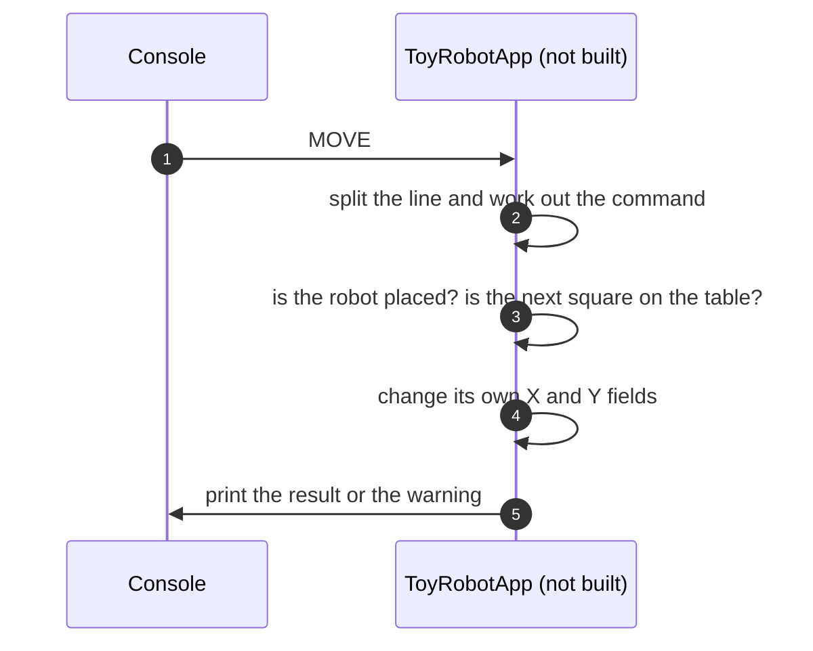

# 8.1 Everything in one class

What the application would look like if a single class did all the work, and why it was not built that way.

**Kind:** an overall design for the whole application, instead of the chosen one.

How to read this page: see [page 8](../08-alternative-solutions.md#how-to-read-the-alternative-pages). Names in the diagram that are not real components are examples only.

## Description

One class, here called `ToyRobotApp`, reads each line from the console, works out the command, checks the table edges, keeps the robot's X, Y and direction in its own fields, and prints the result or the warning itself.

1. The console gives the class a line.
2. The class works out which command it is.
3. The same class checks every rule.
4. It changes its own fields directly.
5. It prints straight to the console.

## Pros

- The least code, and quick to write.
- Everything is in one file, so there is nothing to wire together.

## Cons

- Reading input, parsing, the rules and printing are all mixed, so a change to one can break another.
- It can only be tested through the real console, because the class prints directly. Testing the whole flow in memory with any table size would not be possible ([DEC-29][dec-29], [DEC-31][dec-31]).
- It is harder for a reviewer to follow, and harder to extend, for example with more robots ([DEC-38][dec-38]).

## Why it was not chosen

The code follows SOLID, so each class has one job ([DEC-34][dec-34]). The Runner reads the input and writes all the output. The CommandParser checks the format and turns each line into a command object, EXIT or a failure. Each command class holds only its own logic. RobotOperator holds the rules shared by all commands. The Table checks positions ([DEC-26][dec-26], [DEC-27][dec-27]). The Runner is handed its input and output, so the whole flow can be tested in memory ([DEC-29][dec-29]). The code is meant to be read by others, so it must be easy to follow and extend ([DEC-34][dec-34]).

**Trade-off accepted instead:** "more classes (one per command, plus two small interfaces) than a single class holding all the rules." ([DEC-27][dec-27])

---

Back to [page 8](../08-alternative-solutions.md) · [solution design overview](../README.md)

[dec-26]: ../../design-analysis/design-decisions.md#dec-26-responsibilities
[dec-27]: ../../design-analysis/design-decisions.md#dec-27-each-command-is-a-class-robotoperator-holds-the-shared-rules
[dec-29]: ../../design-analysis/design-decisions.md#dec-29-the-runner-receives-everything-it-uses
[dec-31]: ../../design-analysis/design-decisions.md#dec-31-testing
[dec-34]: ../../design-analysis/design-decisions.md#dec-34-readable-code-solid
[dec-38]: ../../design-analysis/design-decisions.md#dec-38-one-robot-now-room-for-more-later
