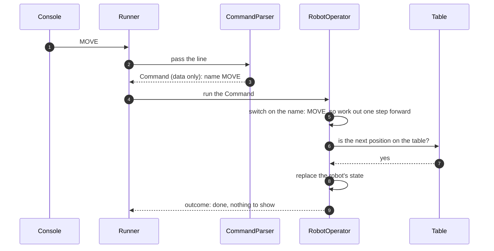

# 8.2 Commands as data, with all rules in RobotOperator

What the application would look like if commands were plain data and one class held every rule for every command, and why it was not built that way.

**Kind:** an overall design for the whole application, instead of the chosen one.

How to read this page: see [page 8](../08-alternative-solutions.md#how-to-read-the-alternative-pages). Names in the diagram that are not real components are examples only.

## Description

The CommandParser returns a `Command` that is only data: a name, such as MOVE, and for PLACE the X, Y and F. It has no behaviour. RobotOperator looks at the name and, in one large `switch`, does what each command needs: it works out the next position for MOVE, turns for LEFT and RIGHT, formats the position for REPORT, and writes every warning.

1. The console gives the Runner a line.
2. The Runner passes it to the parser.
3. The parser returns a Command that only holds data.
4. The Runner passes it to RobotOperator.
5. RobotOperator picks the right branch of its `switch` and works out the next position itself.
6. RobotOperator asks the Table about the next position.
7. The Table answers.
8. RobotOperator replaces the robot's state.
9. RobotOperator returns the outcome.

## Pros

- Every rule for every command is in one class, so a reader can see them all in one place.
- Fewer classes: one data type for all commands instead of one class per command.
- The robot never leaves RobotOperator, so nothing else can change it ([DEC-14][dec-14]).

## Cons

- RobotOperator has more than one job: the rules shared by all commands, plus the logic of each command. It grows with every command.
- Adding a command means changing RobotOperator's `switch` as well as the parser, so existing, tested code changes each time (not open/closed).
- Each command's logic can only be tested through RobotOperator, not on its own.

## Why it was not chosen

The code should follow SOLID: each class has one job, and new behaviour is added with new classes rather than by changing existing ones ([DEC-34][dec-34]). In the chosen design, each command is its own class with only its own logic, and RobotOperator holds only the rules shared by all commands, written once ([DEC-27][dec-27]). The robot is still protected: commands reach it only through `IRobotOperator` ([DEC-14][dec-14]).

**Trade-off accepted instead:** "more classes (one per command, plus two small interfaces) than a single class holding all the rules. The CommandParser still changes when a command is added, because it must recognise the new word." ([DEC-27][dec-27])

---

Back to [page 8](../08-alternative-solutions.md) · [solution design overview](../README.md)

[dec-14]: ../../design-analysis/design-decisions.md#dec-14-only-one-way-to-change-the-robot
[dec-27]: ../../design-analysis/design-decisions.md#dec-27-each-command-is-a-class-robotoperator-holds-the-shared-rules
[dec-34]: ../../design-analysis/design-decisions.md#dec-34-readable-code-solid
