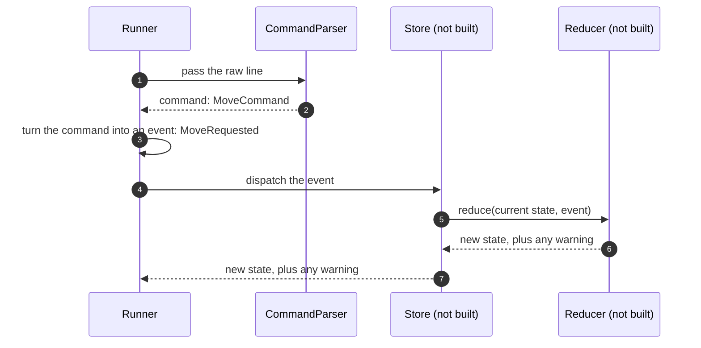

# 8.3 Event-based design with a pure reducer

What the application would look like if each command became an event handled by a pure function, and why it was not built that way.

**Kind:** an overall design for the whole application, instead of the chosen one.

How to read this page: see [page 8](../08-alternative-solutions.md#how-to-read-the-alternative-pages). Names in the diagram that are not real components are examples only.

## Description

The CommandParser returns a command, as in the chosen design, and each command is turned into an **event**, such as "move requested". A **reducer** is a pure function: given the current state and an event, it returns the new state, and it changes nothing else. A **store** keeps the current state, passes each event to the reducer and keeps the result. Because every change is an event, the history of events can be kept and replayed.

1. The Runner passes the raw line to the CommandParser.
2. The CommandParser returns a command, such as MoveCommand or PlaceCommand, as in the chosen design.
3. The Runner turns the command into an event, such as MoveRequested. A dispatcher, or the store itself, could do this translation instead.
4. The Runner dispatches the event to the store.
5. The store calls the reducer with the current state and the event.
6. The reducer returns the new state and any warning, without changing anything itself.
7. The store keeps the new state and tells the Runner the result.

## Pros

- The reducer is a pure function, so it is very easy to test: same input, same output, every time.
- State is never changed in place, which matches the immutable robot state of the chosen design ([DEC-12][dec-12]).
- Undo, replay or a full history of events would be easy to add.

## Cons

- More concepts (events, a store, a reducer) for an application with five commands and one robot.
- Warnings are not state, so the reducer must return them alongside the state, which makes its result more complex.
- Nothing in the challenge needs history, replay or undo.

## Why it was not chosen

The chosen design already gets the main benefit with fewer parts: the robot state is an immutable value ([DEC-12][dec-12]), and it is replaced, never changed in place, through one path for all commands ([DEC-13][dec-13]). Each command class works out the next state, and RobotOperator replaces the robot's state only after the Table has checked it ([DEC-27][dec-27]). Building more than the challenge needs goes against the lasting principle of no over-engineering ([DEC-36][dec-36]).

**Trade-off accepted instead:** there is no history of past states, so features such as undo would need new work.

---

Back to [page 8](../08-alternative-solutions.md) · [solution design overview](../README.md)

[dec-12]: ../../design-analysis/design-decisions.md#dec-12-robot-state-is-an-immutable-value
[dec-13]: ../../design-analysis/design-decisions.md#dec-13-state-is-replaced-never-changed-in-place
[dec-27]: ../../design-analysis/design-decisions.md#dec-27-each-command-is-a-class-robotoperator-holds-the-shared-rules
[dec-36]: ../../design-analysis/design-decisions.md#dec-36-development-approach-design-first-then-spec-driven-with-github-spec-kit
