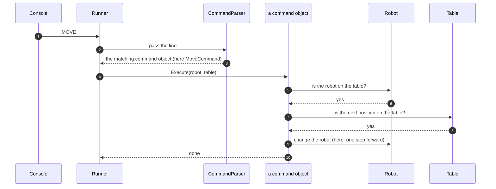

# 8.4 Each command is given the Robot and the Table

What the command classes would look like if each one were handed the Robot and the Table and carried out every rule itself, and why it was not built that way.

**Kind:** a different choice for one part of the chosen design; the other components stay the same.

How to read this page: see [page 8](../08-alternative-solutions.md#how-to-read-the-alternative-pages). Names in the diagram that are not real components are examples only.

## Description

This is the textbook form of the Command pattern. As in the chosen design, each command is its own class (`PlaceCommand`, `MoveCommand`, `LeftCommand`, `RightCommand`, `ReportCommand`). The difference is what a command is given when it runs: the Robot itself and the Table, instead of the narrow `IRobotOperator` interface. There is no RobotOperator holding the shared rules, so each command checks everything itself and changes the robot directly.

**Compared with the chosen design:** RobotOperator and `IRobotOperator` are removed, and the commands do their work themselves. In the chosen design a command is given only `IRobotOperator`, and RobotOperator checks that the robot is on the table, asks the Table and replaces the state (see [7.1 PLACE then REPORT](../07-logical-flow/01-place-then-report.md) and [7.2 MOVE blocked at the edge](../07-logical-flow/02-move-blocked-at-the-edge.md)).

The diagram is the same for every command. The line `MOVE` is used as the example; for `LEFT` the parser would return a `LeftCommand` instead, and its `Execute` would turn the robot.

1. The console gives the Runner a line.
2. The Runner passes it to the parser.
3. The parser returns the object for that command: a `MoveCommand` for `MOVE`, a `PlaceCommand` for `PLACE`, and so on.
4. The Runner calls `Execute`, handing over the Robot and the Table.
5. The command object checks that the robot is on the table. (A `PlaceCommand` skips this check.)
6. The Robot answers.
7. The command object asks the Table about the next position. (A `ReportCommand` skips steps 7 to 9 and returns the position instead.)
8. The Table answers.
9. The command object changes the robot in its own way: MOVE steps forward, LEFT and RIGHT turn, PLACE sets the position.
10. The command tells the Runner it is done.

## Pros

- No RobotOperator and no `IRobotOperator`: fewer types.
- Each command is complete on its own; a reader sees every rule it follows in one class.

## Cons

- The shared rules, "is the robot on the table?" and "check the next position before changing anything", are repeated in four or five classes, or moved into a shared base class. Repeated rules can drift apart, so one command could forget a check.
- Every command holds the Robot, so any command could change it in any way, not only through the single "check, then replace" step ([DEC-13][dec-13], [DEC-14][dec-14]).
- Each command depends on both the Robot and the Table, more than it needs.

## Why it was not chosen

Commands reach the robot only through `IRobotOperator`, a small interface with the current state and one way to change it ([DEC-14][dec-14]). RobotOperator, which implements it, applies the shared rules once for all commands: the robot must be on the table (except for PLACE), and a new state is checked with the Table before it replaces the old one ([DEC-27][dec-27]). This also follows SOLID: parts depend on small interfaces ([DEC-34][dec-34]).

**Trade-off accepted instead:** two small interfaces (`IRobotCommand` and `IRobotOperator`) and RobotOperator, a class that only holds the shared rules. Both designs already have one class per command, so these are the only extra types (see [DEC-27][dec-27]).

---

Back to [page 8](../08-alternative-solutions.md) · [solution design overview](../README.md)

[dec-13]: ../../design-analysis/design-decisions.md#dec-13-state-is-replaced-never-changed-in-place
[dec-14]: ../../design-analysis/design-decisions.md#dec-14-only-one-way-to-change-the-robot
[dec-27]: ../../design-analysis/design-decisions.md#dec-27-each-command-is-a-class-robotoperator-holds-the-shared-rules
[dec-34]: ../../design-analysis/design-decisions.md#dec-34-readable-code-solid
