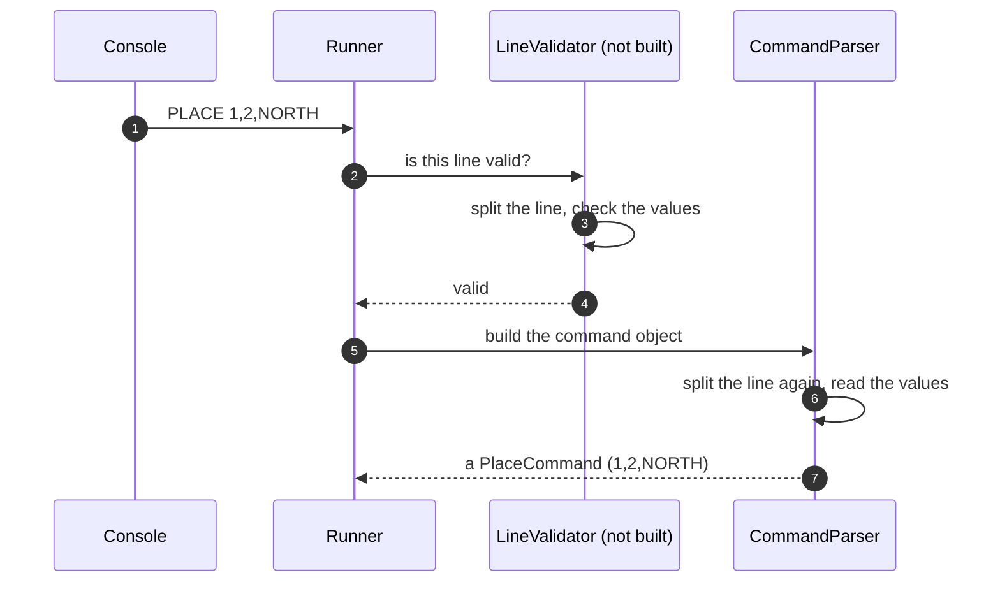

# 8.5 A separate validator before the parser

What the application would look like if one step checked each line and a second step built the command object, and why it was not built that way.

**Kind:** a different choice for one part of the chosen design; the other components stay the same.

How to read this page: see [page 8](../08-alternative-solutions.md#how-to-read-the-alternative-pages). Names in the diagram that are not real components are examples only.

## Description

A `LineValidator` first checks whether a line is a valid command and, if not, gives the reason. Only valid lines go on to the CommandParser, which then builds the command object and can assume the line is correct.

1. The console gives the Runner a line.
2. The Runner asks the validator whether the line is valid.
3. The validator splits the line and checks each value.
4. The validator says it is valid (or gives the reason it is not).
5. The Runner asks the parser to build the command object.
6. The parser splits the same line again and reads the values.
7. The parser returns the command object.

## Pros

- The checks and the building of the command object are in separate places, so each can be tested on its own.
- The parser can be simpler, because it only ever sees valid lines.

## Cons

- Every line is split and read twice, by two pieces of code that must follow exactly the same rules. If they ever disagree, a line could pass the validator and then fail in the parser.
- To give the exact reason for a warning ([DEC-22][dec-22]), the validator has to do almost all the parsing anyway.
- More code for no change in behaviour.

## Why it was not chosen

One simple splitting rule gives every input exactly one result ([DEC-08][dec-08]). The CommandParser does both jobs in one pass: it returns a command object, EXIT, or a failure with the reason used in the warning ([DEC-26][dec-26]). It checks the format only; whether the position is on the table is the Table's job ([DEC-28][dec-28]).

**Trade-off accepted instead:** the CommandParser is the largest component, because checking and building happen together. Its tests cover every row of the [DEC-08][dec-08] table ([DEC-08][dec-08], [DEC-31][dec-31]).

---

Back to [page 8](../08-alternative-solutions.md) · [solution design overview](../README.md)

[dec-08]: ../../design-analysis/design-decisions.md#dec-08-how-a-line-is-read
[dec-22]: ../../design-analysis/design-decisions.md#dec-22-warning-wording
[dec-26]: ../../design-analysis/design-decisions.md#dec-26-responsibilities
[dec-28]: ../../design-analysis/design-decisions.md#dec-28-the-parser-checks-format-the-table-checks-position
[dec-31]: ../../design-analysis/design-decisions.md#dec-31-testing
