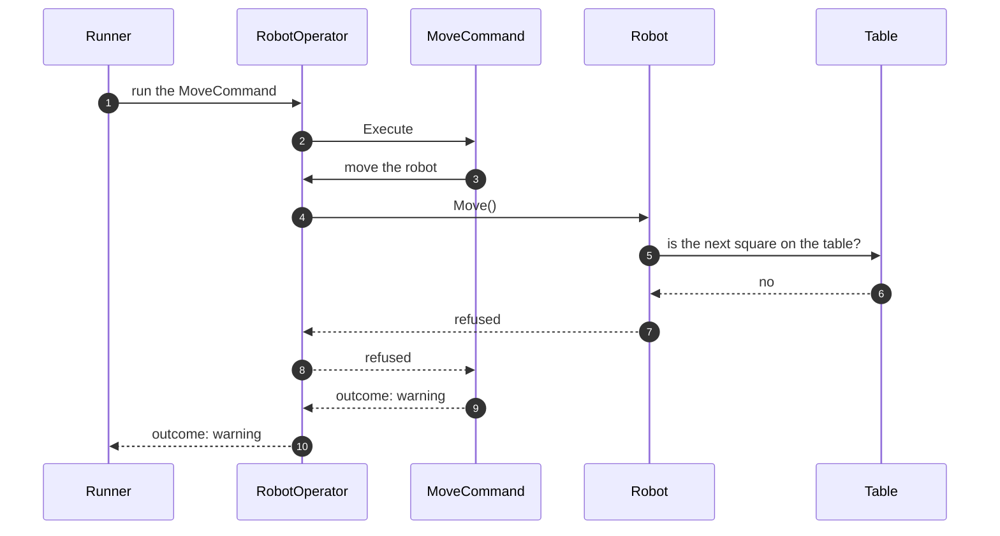

# 8.6 The Robot checks the table itself

What the application would look like if the Robot knew the Table and refused to move off it, and why it was not built that way.

**Kind:** a different choice for one part of the chosen design; the other components stay the same.

How to read this page: see [page 8](../08-alternative-solutions.md#how-to-read-the-alternative-pages).

## Description

The Robot is given the Table when it is created. It has its own methods, such as `Move()`, `TurnLeft()` and `Place(x, y, f)`. Each method checks the Table and changes the robot only if the new position is on the table. The command classes and RobotOperator stay, but a command now asks RobotOperator to call one of these methods instead of working out the next state itself.

1. The Runner passes the command object to RobotOperator.
2. RobotOperator runs the command.
3. The `MoveCommand` asks RobotOperator to move the robot. It no longer works out the next position; the Robot does.
4. RobotOperator asks the Robot to move.
5. The Robot asks the Table about the next square.
6. The Table answers no.
7. The Robot refuses and tells RobotOperator.
8. RobotOperator tells the command.
9. The command returns its warning.
10. RobotOperator passes the warning to the Runner.

## Pros

- The Robot "protects itself": no code can make it fall off, however it is called.
- RobotOperator and the command classes become smaller.

## Cons

- The rules are split: the "is the next square on the table?" rule is in the Robot, the "has the robot been placed?" rule is in RobotOperator, and the warnings are in the command classes.
- The Robot has a method for each command, so there are several ways to change it instead of one ([DEC-14][dec-14]).
- The Robot depends on the Table. With more robots later, a move would also need to check the other robots, which a single Robot cannot see; the rule would have to move out again ([DEC-38][dec-38]).

## Why it was not chosen

The Table checks positions, and RobotOperator applies the rules shared by all commands ([DEC-28][dec-28], [DEC-27][dec-27]). For PLACE, MOVE, LEFT and RIGHT there is one path: the command works out the next state, RobotOperator asks the Table, and replaces the robot's state only if it is on the table ([DEC-13][dec-13]). The Robot has a single replace method that accepts only a real position ([DEC-14][dec-14]). This keeps a future change for several robots local to RobotOperator ([DEC-38][dec-38]).

**Trade-off accepted instead:** "a few more small types (`RobotState`, a nullable placement, a single replace method) than a simple robot with changeable fields." ([DEC-13][dec-13])

---

Back to [page 8](../08-alternative-solutions.md) · [solution design overview](../README.md)

[dec-13]: ../../design-analysis/design-decisions.md#dec-13-state-is-replaced-never-changed-in-place
[dec-14]: ../../design-analysis/design-decisions.md#dec-14-only-one-way-to-change-the-robot
[dec-27]: ../../design-analysis/design-decisions.md#dec-27-each-command-is-a-class-robotoperator-holds-the-shared-rules
[dec-28]: ../../design-analysis/design-decisions.md#dec-28-the-parser-checks-format-the-table-checks-position
[dec-38]: ../../design-analysis/design-decisions.md#dec-38-one-robot-now-room-for-more-later
