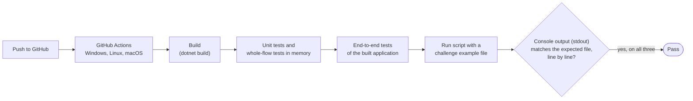

# 9. Considerations

Error handling, output streams and exit codes, testing, cross-platform checks, the run scripts, how the design could grow, and the assumptions, trade-offs, risks and known limitations.

The console terms used on this page (console output, console messages, console input) are defined on the [overview page](README.md).

## Error handling: never crash

No input makes the application crash, including an empty input or a very large number ([DEC-32][dec-32]). Each kind of bad input has a defined, normal result:

| Input | What happens | Decision |
|---|---|---|
| A line that is not a valid command (unknown word, wrong number of values, bad X, Y or F, extra values, blank line) | The CommandParser returns a failure with its reason. The Runner writes it as a warning and reads the next line. No exception is thrown. | [DEC-20][dec-20], [DEC-22][dec-22], [DEC-27][dec-27] |
| X or Y too large for a whole number (`int`) | Read with `int.TryParse`, which answers "not a number" instead of throwing, so the line is a bad line | [DEC-08][dec-08], [DEC-20][dec-20] |
| A position off the table (PLACE or MOVE) | Checked with the Table **before** the robot changes, so there is nothing to undo | [DEC-13][dec-13], [DEC-15][dec-15], [DEC-16][dec-16] |
| A robot command before a valid PLACE | Ignored with a warning; RobotOperator checks this before running the command | [DEC-19][dec-19] |
| An empty input | The session ends at once with exit code 0 | [DEC-10][dec-10] |
| A byte-order mark at the start of the input | Removed, so the first command is read normally | [DEC-20][dec-20] |
| Any argument on the command line | The how-to-run message, then exit code 1 | [DEC-04][dec-04] |
| An unexpected exception: not caused by any input, but by a fault outside the application's control (for example the console or a pipe closing while it writes) or a defect | Program's last safeguard catches it, writes `Error: unexpected problem - <exception message>` to console messages (stderr) instead of a .NET stack trace, and stops with exit code 2. If writing that line fails, it still stops with exit code 2. | [DEC-23][dec-23], [DEC-26][dec-26], [DEC-32][dec-32] |

After every bad line the session carries on, so later valid commands still work, as the challenge requires.

## Output streams and exit codes

Only the REPORT result goes to console output (stdout); everything else goes to console messages (stderr) ([DEC-23][dec-23]):

| What is written | When | Where |
|---|---|---|
| `Output:` and the position, for example `0,1,NORTH` | Every REPORT with the robot on the table | Console output (stdout) |
| Warnings | Every ignored line or command | Console messages (stderr) |
| The `> ` prompt | Only when a person is typing | Console messages (stderr) |
| The echo, `> ` and the line | Only when input is redirected | Console messages (stderr) |
| The how-to-run message | Any argument given | Console messages (stderr) |
| `Error: unexpected problem - <exception message>` | An unexpected problem ([DEC-32][dec-32]) | Console messages (stderr) |

On screen they all appear together. The split matters only when output is saved or compared: `ToyRobot < commands.txt > results.txt` saves only the REPORT results, and `2> warnings.txt` saves the rest.

Exit codes of the application:

| Exit code | When | Decision |
|---|---|---|
| 0 | The input ends, or EXIT is read | [DEC-10][dec-10] |
| 1 | Any argument is given (after the how-to-run message) | [DEC-04][dec-04] |
| 2 | An unexpected problem (after the error line) | [DEC-32][dec-32] |
| Non-zero, set by the system | Ctrl+C: the standard .NET behaviour applies; the application does not handle it | [DEC-10][dec-10] |

The run scripts add their own exit codes; see [Run scripts](#run-scripts).

## Testing strategy

There are three test levels ([DEC-31][dec-31]). Tests use **xUnit** and live in two test projects (folder layout on page [5](05-high-level-design.md#folder-layout-and-the-built-application)).

| Level | What it tests | How | Project |
|---|---|---|---|
| **1. Unit tests** | Table, Direction, CommandParser, RobotOperator and each command class, one at a time | Direct calls with small inputs; any table size | `ToyRobot.Tests` |
| **2. Whole-flow tests in memory** | Runner → CommandParser → RobotOperator → Table, together | The Runner is given a `StringReader` as input and two `StringWriter`s as its outputs, instead of the console ([DEC-29][dec-29]). Console output (stdout) and console messages (stderr) are checked separately and exactly. Program's safeguard is tested the same way, through its internal `Run` method with a reader or writer that fails ([DEC-32][dec-32]). | `ToyRobot.Tests` |
| **3. End-to-end tests** | The built application as a separate process: the real console, `Console.IsInputRedirected`, the UTF-8 input reader and Program | Run the application with each test-data file redirected and compare console output (stdout) with the expected file; run it with an argument and check the how-to-run message and exit code 1; check exit code 0 after the end of input and after EXIT | `ToyRobot.EndToEndTests` |

- **Line by line.** Expected output is compared line by line, so Windows and Linux line endings both pass.
- **Test names** use the challenge wording where possible, for example `Robot_not_on_table_ignores_MOVE`.
- **Test data.** The `testdata/` folder holds input files with matching expected-output files, used by the end-to-end tests and by CI ([DEC-37][dec-37]).
- **What must be covered.** The full list is in [DEC-31][dec-31]. In short: the three challenge examples and the hand-traced examples; every edge and corner; full LEFT and RIGHT cycles; a 2 x 2 table; every robot command before PLACE; invalid, repeated and negative PLACEs; letter case; every row of the [DEC-08][dec-08] table, including tabs and non-breaking spaces; every warning with its exact text; EXIT in every position; the prompt and the echo; an empty input; a byte-order mark; the how-to-run message and exit codes; the unexpected-problem line and exit code 2.
- Page [10](10-traceability.md) shows which test levels prove each functional and non-functional requirement.

### Test flow

What runs on every push, on each of the three systems ([DEC-31][dec-31], [DEC-33][dec-33]):

Any failed build, failed test or mismatch stops the run on that system and marks the push as failed.

## Cross-platform and CI

The application must work on Windows, Linux and macOS ([DEC-33][dec-33], [NFR-02][nfr-02]).

- **Evidence.** A GitHub Actions workflow in `.github/workflows/` builds the application and runs all three test levels on `windows-latest`, `ubuntu-latest` and `macos-latest` on every push. On each system it also runs that system's run script with a challenge example file and compares console output (stdout) with the expected file, line by line.
- **Why CI, not just a note.** Hosted CI gives real machines for all three systems, so macOS is proven without owning a Mac. The end-to-end tests and the script runs cover what is most likely to differ between systems: the real console, text encoding, input redirection, line endings and the scripts.
- **Line endings.** A `.gitattributes` file keeps LF for all text files and CRLF for `.cmd` files. `run.sh` is committed as executable.
- **.NET version** ([NFR-03][nfr-03]). The application targets .NET 8 and rolls forward to a newer installed major version (`RollForward` = `LatestMajor` in the project file), so it also runs where only .NET 9 or later is installed ([DEC-37][dec-37]).
- **The README** says the solution is tested on all three systems through this workflow, and links to it.

## Run scripts

Two scripts at the repository root let a reviewer start the application without knowing the build details ([DEC-37][dec-37], [NFR-08][nfr-08]): `run.cmd` for Windows (cmd and PowerShell) and `run.sh` for Linux and macOS. Each one, in order:

| # | Step | If it fails |
|---|---|---|
| 1 | Checks that a .NET SDK, version 8 or later, is installed | Says where to get it; exit code 1 |
| 2 | Builds the application quietly (`Release`) | Shows the build output; exits with the build's exit code |
| 3 | Checks the arguments: none starts the application for typing; one must be a file that exists, which is fed to the application's console input (stdin) | Missing file: a message, exit code 1. More than one argument: the script's how-to-run message, exit code 1 |
| 4 | Exits with the application's own exit code | — |

The application itself still takes no arguments; the script redirects the file for it ([DEC-04][dec-04]). The scripts write their own messages, and any build output, to console messages (stderr), so console output (stdout) carries only the REPORT results. The wording of the script messages is not fixed.

How to feed a file in each shell ([DEC-04][dec-04]):

| Shell | Command |
|---|---|
| cmd | `run commands.txt` |
| PowerShell | `.\run.cmd commands.txt` |
| bash, zsh | `./run.sh commands.txt` |
| cmd, bash, zsh, without the scripts | `ToyRobot < commands.txt` (path of the built application: page [5](05-high-level-design.md#folder-layout-and-the-built-application)) |
| PowerShell, without the scripts | `cmd /c "ToyRobot < commands.txt"`, because PowerShell does not support `<` |

## Extensibility

None of these is built ([DEC-39][dec-39]). They show that the design leaves room for them, and which parts would change.

| Possible change | What would change | What would not change |
|---|---|---|
| **A new robot command** | A new class implementing `IRobotCommand`, and the CommandParser recognising its word. Its behaviour and warning would first need a new decision. | The existing command classes, RobotOperator, the Table and the Runner ([DEC-27][dec-27], [DEC-34][dec-34]) |
| **More than one robot** | The CommandParser (reading a robot name) and RobotOperator (holding several robots) ([DEC-38][dec-38]) | `RobotState`, the Table, the Runner and the replace-only rule. To keep it this way, there is no static or global Robot, the Table does not hold the robot, and the Robot never reads commands or the console. |
| **A configurable table size** | Only the numbers Program passes to the Table constructor, for example read from a setting ([DEC-03][dec-03]) | Everything else; tests already build other sizes, such as 2 x 2, the same way |
| **A log file** of results and warnings | Only Program: it would give the Runner a writer that writes to both the console and a file ([DEC-29][dec-29], [DEC-39][dec-39]) | The Runner and every other component |

## Assumptions

Where the challenge is silent or open, these are the assumptions the design makes. Each is recorded as a decision.

- The table is 5 x 5 with positions 0 to 4; (0,0) is the SOUTH WEST corner, and NORTH increases Y ([DEC-01][dec-01], [DEC-02][dec-02]).
- Commands come from console input (stdin), typed or redirected from a file; there is no file-name argument ([DEC-04][dec-04]).
- Commands and directions are accepted in any letter case; directions are full words only ([DEC-06][dec-06], [DEC-07][dec-07]).
- An ignored command is reported with a warning on console messages (stderr); the challenge says ignored, not silent ([DEC-19][dec-19], [DEC-22][dec-22]).
- REPORT prints `Output:` and then the position, as in the challenge examples ([DEC-21][dec-21]).
- The `>` in the challenge examples is a prompt, not part of a command ([DEC-09][dec-09], [DEC-24][dec-24]).
- EXIT is added as a second way to end a session, besides the end of input; it works at any point, even before PLACE ([DEC-10][dec-10]).
- How a reviewer will check the solution is not stated; the defaults are assumption A1 (page [12](12-assumptions.md)).

## Trade-offs accepted

Each line is quoted from the decision's "Trade-off" line in design-decisions.md.

| Decision | Trade-off |
|---|---|
| [DEC-03][dec-03] Table size | "a different table size needs a code change in `Program`; accepted to keep the first build simple." |
| [DEC-04][dec-04] Standard input only | "there is no file-name argument, so a file must be redirected; Windows PowerShell has no `<`, so it needs the run scripts or `cmd /c` ([DEC-37][dec-37])." |
| [DEC-08][dec-08] How a line is read | "a wider input format than the challenge shows, and more cases to test (every row above is a test, [DEC-31][dec-31])." |
| [DEC-09][dec-09] A leading `>` | "pasting the challenge examples exactly as printed, with their `>`, gives warnings instead of results (assumption A1)." |
| [DEC-10][dec-10] Ending a session | "a command the challenge does not define, and a looser format for EXIT than for the other commands." |
| [DEC-13][dec-13] State is replaced | "a few more small types (`RobotState`, a nullable placement, a single replace method) than a simple robot with changeable fields." |
| [DEC-19][dec-19] Commands before PLACE | "with warnings (here and in [DEC-20][dec-20]), a run prints more than the challenge examples show; the warnings go to standard error ([DEC-23][dec-23]), so the REPORT output stays exactly as expected." |
| [DEC-21][dec-21] REPORT format | "an automated check that expects only `0,1,NORTH` would see an extra `Output:` line (assumption A1)." |
| [DEC-25][dec-25] Echo | "more text on screen during a file run; it is on standard error only, so the REPORT output is unaffected." |
| [DEC-27][dec-27] Command classes | "more classes (one per command, plus two small interfaces) than a single class holding all the rules. The CommandParser still changes when a command is added, because it must recognise the new word." |
| [DEC-33][dec-33] Cross-platform | "time to set up and maintain the workflow, in exchange for real evidence on all three systems." |

## Risks

| Risk | Effect | How it is handled |
|---|---|---|
| A reviewer checks console output (stdout) automatically against the bare `0,1,NORTH` | The extra `Output:` line fails the check | Assumption A1; the format is documented in the README ([DEC-21][dec-21]) |
| A reviewer feeds the examples with their leading `>` | Warnings instead of results | Assumption A1; the fallback is to accept and remove a leading `> ` ([DEC-09][dec-09]) |
| A reviewer merges console output and console messages | The echo and warnings appear in the compared output | Assumption A1; the fallback is to stop the echo and warnings with redirected input ([DEC-23][dec-23]) |
| .NET 8 support ends in November 2026 | A reviewer may have only .NET 9 or later | The application rolls forward to the newer version (`RollForward` = `LatestMajor`) ([DEC-37][dec-37]) |
| A difference between Windows, Linux and macOS (console, encoding, line endings, scripts) | The application or a script fails on one system | CI runs every test level and the run scripts on all three systems on every push ([DEC-33][dec-33]) |

## Known limitations

| Limitation | Why | Decision |
|---|---|---|
| Windows PowerShell has no `<`, so a file cannot be redirected directly | A PowerShell limitation; use the run scripts or `cmd /c` | [DEC-04][dec-04] |
| In Windows PowerShell 5.1, `>` saves output as UTF-16 | A PowerShell default; use cmd or the run scripts when saving output | [DEC-23][dec-23] |
| An unexpected problem shows one line, `Error: unexpected problem - <exception message>`, not a full stack trace | The safeguard keeps the message clear for a user; a defect is still caught by the tests, which check output and exit codes exactly | [DEC-32][dec-32] |
| Ctrl+C stops the application with a non-zero exit code set by the system | The application does not handle Ctrl+C; the standard .NET behaviour applies | [DEC-10][dec-10] |
| When a typed session ends with Ctrl+Z / Ctrl+D, the last `> ` prompt stays on screen | The prompt was already shown before the end of input was read; this is expected | [DEC-10][dec-10] |
| X or Y larger than about 2.1 billion gives "must be a whole number", although it is one | Values that do not fit in an `int` cannot be read as a number; they could never be on the table anyway | [DEC-20][dec-20] |
| An invisible character that is not whitespace (such as a zero-width space), or a look-alike letter from another alphabet, makes a line a bad line whose quote in the warning looks correct | Only whitespace is removed (what `Trim()` removes); other characters are part of the command. Non-breaking spaces and tabs are whitespace, so they are handled. | [DEC-08][dec-08], [DEC-22][dec-22] |
| The table size is fixed at 5 x 5 | The challenge fixes it; a different size needs a change in Program | [DEC-03][dec-03] |
| One robot only | The rules for several robots are not defined | [DEC-38][dec-38] |

---

Back to the [solution design overview](README.md).

[dec-01]: ../design-analysis/design-decisions.md#dec-01-table-size-and-valid-positions
[dec-02]: ../design-analysis/design-decisions.md#dec-02-origin-and-directions
[dec-03]: ../design-analysis/design-decisions.md#dec-03-table-size-is-a-constructor-parameter
[dec-04]: ../design-analysis/design-decisions.md#dec-04-standard-input-only
[dec-06]: ../design-analysis/design-decisions.md#dec-06-commands
[dec-07]: ../design-analysis/design-decisions.md#dec-07-case-insensitive
[dec-08]: ../design-analysis/design-decisions.md#dec-08-how-a-line-is-read
[dec-09]: ../design-analysis/design-decisions.md#dec-09-a-leading--is-not-part-of-a-command
[dec-10]: ../design-analysis/design-decisions.md#dec-10-ending-a-session
[dec-13]: ../design-analysis/design-decisions.md#dec-13-state-is-replaced-never-changed-in-place
[dec-15]: ../design-analysis/design-decisions.md#dec-15-place
[dec-16]: ../design-analysis/design-decisions.md#dec-16-move
[dec-19]: ../design-analysis/design-decisions.md#dec-19-robot-commands-before-the-robot-is-on-the-table
[dec-20]: ../design-analysis/design-decisions.md#dec-20-bad-lines
[dec-21]: ../design-analysis/design-decisions.md#dec-21-report-format
[dec-22]: ../design-analysis/design-decisions.md#dec-22-warning-wording
[dec-23]: ../design-analysis/design-decisions.md#dec-23-output-channels
[dec-24]: ../design-analysis/design-decisions.md#dec-24-prompt
[dec-25]: ../design-analysis/design-decisions.md#dec-25-echo-with-redirected-input
[dec-26]: ../design-analysis/design-decisions.md#dec-26-responsibilities
[dec-27]: ../design-analysis/design-decisions.md#dec-27-each-command-is-a-class-robotoperator-holds-the-shared-rules
[dec-29]: ../design-analysis/design-decisions.md#dec-29-the-runner-receives-everything-it-uses
[dec-31]: ../design-analysis/design-decisions.md#dec-31-testing
[dec-32]: ../design-analysis/design-decisions.md#dec-32-never-crash
[dec-33]: ../design-analysis/design-decisions.md#dec-33-cross-platform
[dec-34]: ../design-analysis/design-decisions.md#dec-34-readable-code-solid
[dec-37]: ../design-analysis/design-decisions.md#dec-37-deliverables
[dec-38]: ../design-analysis/design-decisions.md#dec-38-one-robot-now-room-for-more-later
[dec-39]: ../design-analysis/design-decisions.md#dec-39-not-included
[nfr-02]: 03-non-functional-requirements.md#nfr-02
[nfr-03]: 03-non-functional-requirements.md#nfr-03
[nfr-08]: 03-non-functional-requirements.md#nfr-08
